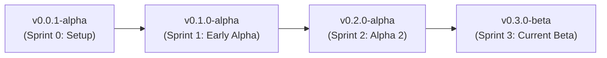

# Release Management & Delimited Releases Log

The Study Progress Analysis (SPA) project follows [Semantic Versioning 2.0.0](https://semver.org/) (`0.MAJOR.MINOR-PRERELEASE`).
The project is currently in the **Beta Development Stage**, transitioning from early **Alpha** milestones. Each major iteration milestone is delimited by its corresponding sprint boundary and published as a tagged release in Git.

---

## 🚀 Release v0.3.0-beta — Current Beta Milestone (Delimited by Sprint 3)
* **Release Date:** September 29, 2026 (`15.09.2026 – 29.09.2026`)
* **Stage:** **Beta Release (Latest)**
* **Sprint Cycle:** **Sprint 3**
* **Velocity Delivered:** 69 Story Points (27 Work Items)
* **GitLab Release Branch:** [`release/sprint-3-v0.3.0-beta`](https://gitlab.gwdg.de/sudarshan.bashyal/d2-project-client/-/tree/release/sprint-3-v0.3.0-beta)
* **GitLab Tag:** [`v0.3.0-beta`](https://gitlab.gwdg.de/sudarshan.bashyal/d2-project-client/-/tags/v0.3.0-beta) (`release-sprint-3-v0.3.0-beta`)

### Key Features Delivered
1. **Course Drive & Document Hub:**
   - Centralized file drive architecture per course (`US-01 #101369`, `US-02 #101370`, `US-03 #101371`, `US-04 #101373`).
   - Integrated source spreadsheet download and audit tracking.
2. **Advanced Exam Comparison & Multi-Filter:**
   - Side-by-side exam attempt comparison engine (`#101779`).
   - Synchronized mirrored semester and exam sitting filters (`#101780`).
   - Course marks semester traceability column (`#101782`).
   - Lecture-only grade modification guards (`#99908`).
3. **Tabular Data Ingestion Studio:**
   - Direct spreadsheet copy-paste (`Ctrl+V`) into AG Grid (`#95949`).
   - Consolidated upload modal merging drag-and-drop and clipboard paste (`#99901`).
4. **Student Data Profile Suite:**
   - Full student CRUD with unique Matrikelnummer enforcement and 409 conflict handling (`#97930`).
5. **Dynamic Configuration & Enterprise Deployment:**
   - Client startup environment injection via `/config.js` (`VITE_API_BASE_URL`).
   - Hardened backend CORS configuration (`CORS_ORIGINS`).
   - In-browser settings modal with live connection test and 10-tap Developer Mode Easter egg.

---

## 📦 Release v0.2.0-alpha — Alpha Milestone 2 (Delimited by Sprint 2)
* **Release Date:** September 14, 2026 (`01.09.2026 – 14.09.2026`)
* **Stage:** **Alpha Release 2**
* **Sprint Cycle:** **Sprint 2** (9 Work Items)
* **GitLab Release Branch:** [`release/sprint-2-v0.2.0-alpha`](https://gitlab.gwdg.de/sudarshan.bashyal/d2-project-client/-/tree/release/sprint-2-v0.2.0-alpha)
* **GitLab Tag:** [`v0.2.0-alpha`](https://gitlab.gwdg.de/sudarshan.bashyal/d2-project-client/-/tags/v0.2.0-alpha) (`release-sprint-2-v0.2.0-alpha`)

### Key Features Delivered
1. **Grade-Driven Pass/Fail Calculation & Absence Parsing (`#96054`):**
   - Automatically computes passing threshold (`grade <= 4.0`) with normalized absence codes (`na`, `ta`, `ne`).
2. **Aggregated Data View: Per-Person History (`#99859`):**
   - Longitudinal student history view displaying transcripts across semesters.
3. **Categorize Exam Attempts & Handle Missing Study Programs (`#96055`):**
   - Attempt categorization (`Exam 1`, `Exam 2`, `Other`) with graceful fallback for unassigned study programs.
4. **Ingestion & Dashboard Bug Fixes (`#99879`, `#99881`, `#99895`):**
   - Fixed drag-and-drop window freeze; fixed alphabetical semester sort to strict chronological order.
5. **Exam Distribution Metrics (`#99900`):**
   - Calculated and rendered student exam counts per semester.
6. **Core Ingestion Verification (`#95732`, `#96053`):**
   - Required field validation and initial spreadsheet import.

---

## 🏛️ Release v0.1.0-alpha — Early Alpha Milestone (Delimited by Sprint 1)
* **Release Date:** August 31, 2026 (`18.08.2026 – 31.08.2026`)
* **Stage:** **Alpha Release 1**
* **Sprint Cycle:** **Sprint 1**
* **GitLab Release Branch:** [`release/sprint-1-v0.1.0-alpha`](https://gitlab.gwdg.de/sudarshan.bashyal/d2-project-client/-/tree/release/sprint-1-v0.1.0-alpha)
* **GitLab Tag:** [`v0.1.0-alpha`](https://gitlab.gwdg.de/sudarshan.bashyal/d2-project-client/-/tags/v0.1.0-alpha) (`release-sprint-1-v0.1.0-alpha`)

### Key Features Delivered
1. **Multi-Format Spreadsheet Ingestion Foundations:**
   - Parsing engine supporting `.xlsx`, `.csv`, `.tsv`, and `.ods`.
2. **Data Validation Engine:**
   - Pre-commit missing field inspection and invalid row flagging.
3. **Atomic Transaction Guarantees:**
   - Zero partial saves; all-or-nothing database flush and commit.
4. **Interactive AG Grid Preview:**
   - Inline typo corrections and approved absence handling prior to permanent archival.

---

## 🏗️ Release v0.0.1-alpha — Project Inception Milestone (Delimited by Sprint 0)
* **Release Date:** August 17, 2026 (`04.08.2026 – 17.08.2026`)
* **Stage:** **Alpha Inception**
* **Sprint Cycle:** **Sprint 0: Ignition**
* **GitLab Release Branch:** [`release/sprint-0-ignition`](https://gitlab.gwdg.de/sudarshan.bashyal/d2-project-client/-/tree/release/sprint-0-ignition)
* **GitLab Tag:** [`release-ignition-sprint-0`](https://gitlab.gwdg.de/sudarshan.bashyal/d2-project-client/-/tags/release-ignition-sprint-0)

### Key Features Delivered
1. **Repository Topology & Stack Selection:**
   - Decoupled client (`d2-project-client`) and backend (`d2-project-backend`) repositories.
   - Initial Docker Compose orchestration with PostgreSQL 15.
2. **Quality Infrastructure & Linting:**
   - Type-aware ESLint 9 configuration, Pytest test runner, and Vitest setup.
3. **Traceability Framework:**
   - Base traceability conventions connecting user requirements to code.
