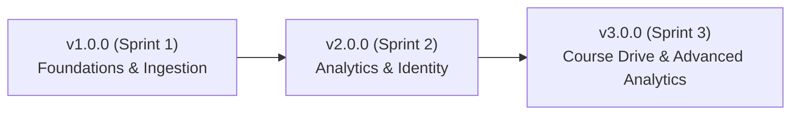

# Release Management & Delimited Releases Log

The Study Progress Analysis (SPA) project strictly follows [Semantic Versioning 2.0.0](https://semver.org/) (`MAJOR.MINOR.PATCH`).
Each major iteration milestone is delimited by its corresponding sprint boundary.

---

## 🚀 Release v3.0.0 — Course Drive, Exam Analytics & Deployment Hardening
* **Release Date:** September 29, 2026
* **Sprint Cycle:** **Sprint 3 (09/15/2026 – 09/29/2026)**
* **Velocity Delivered:** 69 Story Points (27 Work Items)
* **GitLab Tags:** `v3.0.0` (Client), `v3.0.0` (Backend)

### Key Features Delivered
1. **Course Drive & Document Hub:**
   - Centralized file drive architecture per course (`US-01 #101369`, `US-02 #101370`, `US-03 #101371`, `US-04 #101373`).
   - Integrated source spreadsheet download and audit tracking.
2. **Advanced Exam Comparison & Multi-Filter:**
   - Side-by-side exam attempt comparison engine (`#101779`).
   - Synchronized mirrored semester and exam sitting filters (`#101780`).
   - Course marks semester traceability column (`#101782`).
   - Lecture-only grade modification guards (`#99908`).
3. **Tabular Data Ingestion Studio:**
   - Direct spreadsheet copy-paste (`Ctrl+V`) into AG Grid (`#95949`).
   - Consolidated upload modal merging drag-and-drop and clipboard paste (`#99901`).
4. **Student Data Profile Suite:**
   - Full student CRUD with unique Matrikelnummer enforcement and 409 conflict handling (`#97930`).
5. **Dynamic Configuration & Enterprise Deployment:**
   - Client startup environment injection via `/config.js` (`VITE_API_BASE_URL`).
   - Hardened backend CORS configuration (`CORS_ORIGINS`).
   - In-browser settings modal with live connection test and 10-tap Developer Mode Easter egg.

---

## 📦 Release v2.0.0 — Visual Analytics & Authenticated Identity
* **Release Date:** September 14, 2026
* **Sprint Cycle:** **Sprint 2 (09/01/2026 – 09/14/2026)**
* **GitLab Tags:** `v2.0.0` (Client), `v2.0.0` (Backend)

### Key Features Delivered
1. **Secure University Authentication:**
   - SSE domain enforcement (`@uni-hildesheim.de`) (`#95642`).
   - JWT Access tokens (in-memory) & rotating HttpOnly refresh cookies.
   - Global session gate and role-aware navigation.
2. **Visual Analytics Suite:**
   - Longitudinal student trajectories over time (`Recharts LineChart`).
   - Comparative grade distribution histograms with student percentile highlight.
   - Pass vs. Fail breakdown donuts.
3. **Exam Attempt Categorization:**
   - Categorized attempts (`Exam 1`, `Exam 2`, `Other`) with schema migration.
   - Graceful study program normalization handling missing data.

---

## 🏛️ Release v1.0.0 — Core Ingestion & Data Foundations
* **Release Date:** August 31, 2026
* **Sprint Cycle:** **Sprint 1 (08/18/2026 – 08/31/2026)**
* **GitLab Tags:** `v1.0.0` (Client), `v1.0.0` (Backend)

### Key Features Delivered
1. **Multi-Format Spreadsheet Ingestion:**
   - Parsing engine supporting `.xlsx`, `.csv`, `.tsv`, and `.ods` (`#95732`).
2. **Data Validation Engine:**
   - Pre-commit missing field inspection and invalid row flagging.
3. **Atomic Transaction Guarantees:**
   - Zero partial saves; all-or-nothing database flush and commit.
4. **Interactive AG Grid Preview:**
   - Inline typo corrections and approved absence (`na`/`ta`) handling prior to permanent archival.
